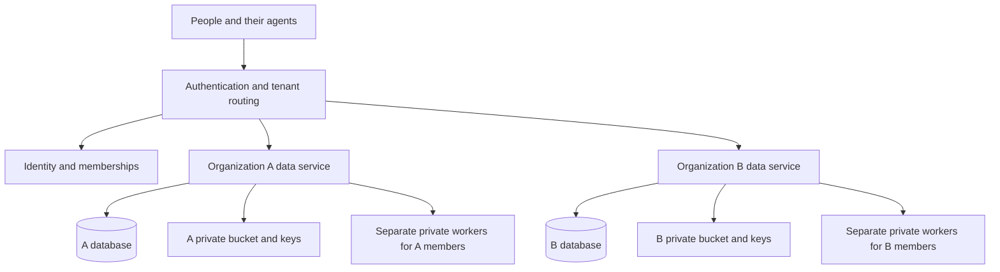

# Organizations and tenant isolation

This contract starts with the owner's organization as the sole tenant. The
implementation adds explicit organization and membership bindings
to that deployment, preserving its existing data and clients. It adds no billing,
subscription plans or customer signup. Future commercial use is a low-priority
possibility and supplies no requirement to build payment infrastructure now.

The delivery order and acceptance requirements are in [the plan](TOOLSTACK-PLAN.md#organization-delivery).

An organization is the tenant and security boundary.
Each person has a private workspace within it. Sharing can make selected content
or account access available to teammates without exposing private activity.
Nothing shared in one organization becomes available in another.

## Implemented sole-tenant foundation

Production requires an immutable `TOOLSTACK_ORG_ID` UUID. The current organization
has its own Postgres service and private Wasabi bucket with scoped credentials.
The database permits one organization record and refuses a different startup
binding. Volume markers and the encrypted gateway store enforce the same rule.

Membership IDs are UUIDv5 values derived from that organization and an immutable
user alias. The existing `owner` workspace and client keys retain their identity;
they cannot select another organization through a header. A new person requires
a new alias. Signed worker claims require both organization and membership IDs,
and every internal gateway request requires the matching organization header.

Library migration 2 backfills non-null organization and owner-membership fields
on packages, versions and files. Composite foreign keys bind child records to
their parent and owner. Assignments resolve to membership IDs, while legacy user
aliases remain in compatible API fields. Application authorization checks these
bindings before storage access. Existing encrypted object keys remain readable;
new keys include the organization UUID.

Private, Selected teammates and Organization are the sharing labels. The sidebar
shows the organization name and My workspace. One membership needs no switcher.
There are no billing tables, payment integrations or customer-signup flows.

The database request role still owns its tables and runs migrations; row-level
security and a separate migration role remain future hardening. The current
gateway combines organization data and authentication for this sole tenant.
Independent customer services, lifecycle controls and their acceptance checks
must precede admitting an unrelated organization. The sections below describe
that expansion target, rather than a claim of completed commercial readiness.

## Identity and membership

Keep a person's login identity separate from their organization memberships.
A person may eventually belong to several organizations. Each membership has its
own roles and workspace; the same login grants no cross-organization data access.

| Record | Responsibility |
| --- | --- |
| User | Stable login identity and authentication settings |
| Organization | Immutable ID, editable name, lifecycle state and isolation resources |
| Membership | Organization, user, role, lifecycle state and authorization version |
| Workspace | One membership's private worker, volume and vault |
| App grant or API key | One membership, permitted operations and revocable credentials |
| Resource | Organization, personal or organization ownership, visibility and version |

Use opaque IDs for authorization. Names, email addresses and URL slugs are display
or discovery fields. Enforce one active membership per user in an organization;
an invitation must be accepted by its intended verified identity. Removing and
reinviting someone must not revive old keys, app grants or assignments.

The effective principal carries verified `org_id`, `user_id`, `membership_id`,
app/key identity, permitted scopes and authorization version. The gateway derives
this context from authentication and current membership. An organization ID in a
URL or header is a request to select an authorized context. It supplies no authority.

Bind OAuth approvals, refresh tokens, cookies and direct API keys to that context.
An agent connection stays attached to one organization until explicitly connected
to another. Switching the dashboard must not retarget an existing MCP connection
or a running job. Downstream services verify the organization, intended recipient
and membership binding before accepting a signed claim.

Use established identity tooling for customer sign-in, MFA and account recovery.
Keep human authentication separate from hosted MCP authorization and provider
OAuth. A shared bootstrap key must not become the customer identity system.
Organization services independently check membership and resource grants; a
gateway routing decision alone does not authorize data access.

## Personal and organization resources

Private work is scoped to a membership's workspace. A person belonging to two
organizations gets separate browser state and account bindings in each. Copying
content between organizations requires an authorized export/import with new
resource IDs and an explicit destination. Credentials and history are excluded
from content copies.

| Scope | Who can access it | Who manages it |
| --- | --- | --- |
| Personal, private | Its creator in that organization | Creator |
| Personal, assigned | Creator and selected active memberships in that organization | Creator |
| Personal, shared with organization | Creator and active members in that organization | Creator, subject to organization publication policy |
| Organization-owned | Active members allowed by that resource's grants | Designated organization maintainers |

Use Private, Selected teammates and Organization as product labels.
Existing `global` identifiers become compatibility names for organization-wide
scope. They must have an organization binding. There is no platform-wide customer
content scope. A future public marketplace would require separate opt-in
publication, review and credential-free distribution.

Organization-wide publication includes future active members. Show that audience
in the confirmation; selected-teammate grants address specific memberships.

Sharing and ownership are separate. Sharing a personal skill leaves its ownership
with its creator and can be withdrawn. To retain a method as a team asset, its
owner explicitly promotes a selected version to organization ownership. Copy only
that version and its selected files; private history and removed attachments stay
private. Record provenance without granting access to the private source package.

On membership suspension, personal shares become unavailable to others. Items
already promoted to organization ownership remain with their organization.
Document retention and the member's authorized export window before offboarding;
an administrator cannot acquire private content through suspension or removal.

Removing an assignment must also withdraw the recipient's access to its private
source. An exported or independently retained copy cannot be recalled by changing
Toolstack permissions. Apply publication and export controls before distributing
sensitive material.

Skills, scripts and reference assets remain application content. Publishing a
package grants neither provider-account access nor permission to execute arbitrary
code in the application process. Organization administrators cannot install trusted
platform modules through a content upload.

Roll out common application code and connector schemas across organizations
without carrying customer packages or account bindings with them. Reuse the same
versioned implementation while keeping each organization's data and configuration
within its own boundary.

## Administration and privacy

Future administration can add Owner, Admin and Member roles. Delegate publication
through separate permissions when needed. Roles manage the organization; resource grants
control use of its content and accounts.

| Authority | Permitted responsibility | Private-data boundary |
| --- | --- | --- |
| Owner | Organization settings, administrator appointments, ownership transfer and closure | No member impersonation or access to another member's private workspace |
| Admin | Membership operations and explicitly assigned shared-resource administration | No private history, files, credentials or browser viewing |
| Member | Own workspace and resources explicitly shared with them | No other member's private resources |
| Platform operator | Infrastructure operation and separately authorized support | No routine customer-content access through application administration |

Require strong identity authentication and step-up verification for privileged
changes. Preserve a recoverable last owner through an explicit ownership-transfer
procedure. An agent app's tool scopes do not include membership or billing
administration by default.

Organization owners may see membership changes, shared-resource administration
and the usage totals needed to manage spend. Private prompts, browsing history
and output bodies stay out of administrative reports. A shared credential does
not make a member's execution history visible to its owner.

Infrastructure operators retain privileged technical access. Separate those
credentials from customer request handling. Exceptional support access needs an
authorized reason, limited duration and an audit trail, with customer notification
under the published support policy. Do not represent this design as zero-knowledge
storage or a compliance certification.

## Shared credentials

Each connection belongs to a private workspace or one organization. Its grants
identify eligible memberships and allowed operations. Organization-wide use must
be an explicit grant. Members discover and use permitted shared accounts while
their browser profiles and activity remain private.

Separate permission to use a credential from permission to reveal or export it.
Normal tools receive account references and bounded operations. Trusted adapters
or a credential broker resolve secrets for approved provider destinations;
uploaded tenant code receives no vault master key or ambient platform secrets.
Granting arbitrary code raw credentials would also grant the ability to copy them.

Apply the same organization binding to provider OAuth callbacks and token renewal.
Rotating or disconnecting an account must not affect another organization. Revoke
Toolstack access on offboarding and surface any required provider-side session
revocation or secret rotation. Previously issued website sessions have their own
lifecycle.

Local login-code access remains the permission of the person performing the
sign-in. The owner's existing Apple Mail/Messages permission supplies no authority
to inspect teammates' messages.

## Infrastructure boundaries

Future multi-organization hosting can use a shared control service for login
identities and organization membership. Customer content and execution belong in isolated organization services.
For the initial commercial design, give every organization a dedicated data
service, Postgres database/service and private Wasabi bucket, with independent
service credentials and encryption keys. The existing database and bucket belong to the initial organization.

Every private workspace also has a dedicated worker, volume and vault key.
The same person working in two organizations must not reuse a browser process
or profile directory between them. Shared hosting hardware requires enforced
process, filesystem and network isolation. Workloads from different organizations
must not run in one application process with access to each other's secrets.

The shared gateway authenticates and routes requests; it does not need a library
database password or object-decryption key for every customer. Organization
services hold only their own data-plane credentials. Private workers receive
only their workspace credentials and narrowly authenticated service access.
Provisioning authority remains outside these request-serving processes.

Browser and compute egress must block platform metadata, private service networks
and other tenants' endpoints, including redirect and DNS-rebinding paths. A future
customer private-network integration requires a separate organization-bound
network policy. Isolate temporary files and crash artifacts along with normal
outputs.

Keep per-member and per-organization limits for storage, concurrency and spend,
plus platform-wide admission limits. One organization's large upload or expensive
job must not exhaust another's database connections or browser capacity. Measure
the cost of this isolation before publishing subscription allowances. Shared
customer-data hosting requires a separate design and isolation review.

Provision organization resources through one idempotent procedure with an explicit
organization-to-resource inventory. Record partial failures and resume without
borrowing another tenant's keys. Coordinate schema and application versions per
organization, with a canary and compatible rollback. Avoid a separate custom
application fork for each customer.

## Data authorization

Every tenant-owned record carries a non-null organization ID. Within the same
database, use organization-qualified parent/child constraints and uniqueness
rules so a version, assignment or artifact cannot reference another tenant.
Membership references across databases require verification against the control
service; a local lookup copy is not independent authorization authority.

Apply application authorization and Postgres row-level policies to tenant and
personal-resource access. Request roles must have no schema-changing privileges,
superuser status or `BYPASSRLS`; migrations use a separate credential. Enable and
force row security where applicable. Set verified authorization context inside
each transaction and fail closed when it is absent. PostgreSQL documents both
[RLS bypass privileges](https://www.postgresql.org/docs/18/ddl-rowsecurity.html)
and the transaction lifetime of [SET LOCAL](https://www.postgresql.org/docs/18/sql-set.html).

Transaction settings are supplied by trusted server code. They do not protect
against a compromised application that can replace those settings. Dedicated
organization credentials and services provide a further boundary. The current
library application role owns its tables and runs migrations; separating those
privileges is migration work.

Wasabi policies restrict each service key to its organization's bucket. Use
opaque object names and bind new encrypted payloads to organization and object
identity. Application reads recheck organization and resource access; knowing an
object key or checksum grants no access. Prefixes alone do not establish isolation.

Carry verified organization and membership context through background jobs and
retry records. Recheck current permissions before queued work starts and before
publishing a result. Namespace caches, deduplication and search indexes with the
same scope. Cancellation, subscription changes and revocation cannot silently
replay an operation whose external effect is uncertain.

Raw CDP, live views and download handoffs enforce the same context as REST and
MCP. Protect existence and metadata as well as bytes: lists, counts, search
results and error responses must not reveal foreign resources. Cross-tenant
requests use a consistent unavailable response.

Permission caches must support the plan's five-second revocation target. Missing
or unavailable membership authority stops new protected work. Removing access
closes controlled streams and prevents queued work from starting; already
disclosed bytes and external effects cannot be retracted.

Backups and deletion follow organization boundaries. Restore into an isolated
destination, reconcile current memberships and revocations, and verify scope
before making restored data available. Deletion covers copies and derived indexes
under a published retention policy; a restore must not resurrect removed access.
These requirements follow the risks catalogued by
[OWASP's multi-tenant security guidance](https://cheatsheetseries.owasp.org/cheatsheets/Multi_Tenant_Security_Cheat_Sheet.html).

## Product experience

With one organization, the owner should see a direct path to their workspace.
Show the organization name and a My workspace / Organization distinction;
add an organization switcher only when the person has multiple memberships.
Agent approval pages name the organization and permitted account scope.

Sharing previews show the audience before confirmation. A teammate picker lists
eligible members in the active organization. Distinguish sharing a personal item
from making an organization-owned copy. Show shared accounts with their source
and allowed operations; avoid exposing another person's private account labels.

Administrators get membership, organization settings and authorized billing views.
Private activity remains in each member's workspace. Empty states explain how to
create private content or request a shared resource. An expired invitation,
suspension or exhausted allowance needs a specific recovery action that preserves
the selected organization and any safely saved draft.

## Optional commercial future

This section records a possible later direction. It is outside the sole-tenant
implementation and teammate rollout.

The initial organization is an internal account with no payment required. If
commercial subscriptions are pursued later, model
an organization's plan and entitlements independently of authentication so future
paid customers use the same permission checks.

Associate billing customer and subscription IDs with the organization. Track
billable membership and resource usage separately from login identity. Use a
durable usage ledger with reservation and reconciliation for storage, execution
and provider costs. Define billable units and cancellation behavior before
publishing prices; current per-worker allowances cannot enforce an organization
subscription limit.

Verified, idempotent billing events update local subscription state. Handle
duplicates and out-of-order events without regranting expired entitlements.
Billing IDs, checkout returns and plan upgrades confer no data access. Never store
payment-card details in Toolstack.

Before charging external organizations, implement onboarding, recovery and owner
transfer with audited lifecycle controls. Verify tenant isolation and independent
backup restoration, and document retention, export, deletion and incident support.
Publish measured service targets and perform an independent security assessment.
Organization SSO and automated provisioning can follow enterprise requirements.

Separate cancellation, payment grace and security suspension. State when new work
stops and how authorized exports or recovery remain available. Charging and
retention policy changes must not expose private workspaces or destroy data
without the documented notice and deletion process.
